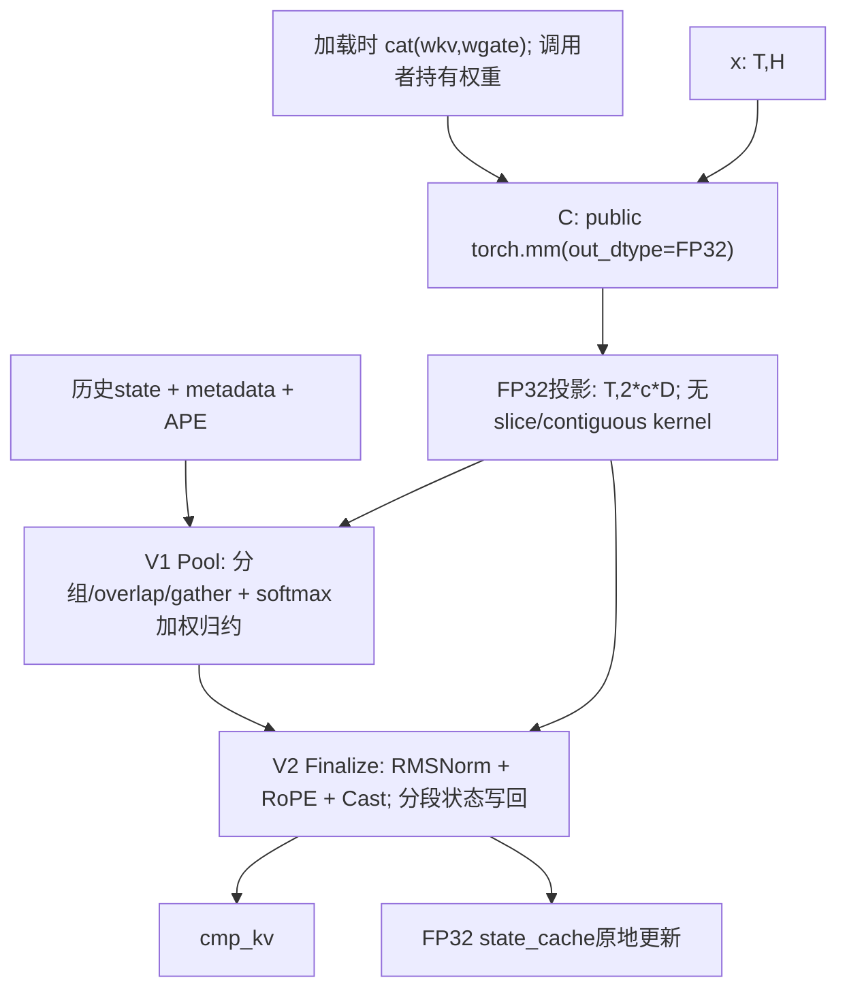

# A3 Compressor: Torch MatMul + Ascend C Vector

本实现面向模型适配初期的简单串行替代路径。C 只调用公开 Torch 接口，V 使用原创 Ascend C；没有阅读或复用原融合 Compressor 的计算 kernel、tiling、golden 或反汇编。

## 范围与接口

支持 A3、TND、连续 FP32 状态缓存、interleave RoPE64，以及 C4Li/C4A/C128A 三个业务族。支持 BF16/FP16；需要显式 cu_seqlens 和 start_pos，seqused 可以为空。BSH、ring cache、其他 ratio/coff 组合和省略 start_pos 的路径明确拒绝。没有修改现有融合算子或模型的默认 dispatch，没有 A5 或模型端到端性能结论。

```python
compressor_serial(
    x, wkv, wgate, state_cache, ape, norm_weight, rope_sin, rope_cos,
    state_block_table, cu_seqlens, seqused, start_pos,
    rope_head_dim, cmp_ratio, coff, norm_eps, rotary_mode, cache_mode,
    *, packed_weight=None,
) -> cmp_kv
```

| 参数 | 形状 / 类型 | 含义 |
| --- | --- | --- |
| x | [T,H], BF16/FP16 | 当前 hidden states；H 是 hidden width |
| wkv, wgate | 各 [c*D,H], 与 x 同类型 | KV/gate 投影权重 |
| state_cache | [blocks,block_size,2*c*D], FP32 | 原地更新；前半 KV，后半 gate+APE |
| ape | [r,c*D], FP32 | 按绝对位置模 r 取偏置 |
| norm_weight | [D], FP32 | 对 D 全维做 RMSNorm |
| rope_sin, rope_cos | [capacity,64], FP32 | 对输出最后64维做 interleave RoPE |
| table | [B,table_columns], INT32 | 物理页映射；0页不写回 |
| cu_seqlens | [B+1], INT32 | 每请求输入 token 前缀和 |
| seqused | [B], INT32 或 None | 有效 token 数；None 表示全部有效 |
| start_pos | [B], INT32 | 当前请求的绝对起始位置 |
| cmp_kv | [capacity,D], 与 x 同类型 | 有效行按请求连续排列，候选 padding 为0 |

令 r=cmp_ratio、c=coff。所有 Tensor 连续且同设备。当前上限 B=256、block_size=1..1024、H=1024..10240 且512对齐。调用者保证 metadata 值合法、页索引有效、并发写入位置没有冲突、输出容量足够。标准 TND 容量为 min(T,T//r+B)，实际分配沿用 rope_sin.shape[0]。静态属性检查不会通过 Tensor.item() 将设备数据同步回 CPU。

| 业务族 | r | c | D | 各投影输出 | 预拼后的单次矩阵乘 |
| --- | ---: | ---: | ---: | --- | --- |
| C4Li | 4 | 2 | 128 | [T,256] | [T,H] @ [H,512] -> FP32 |
| C4A | 4 | 2 | 512 | [T,1024] | [T,H] @ [H,2048] -> FP32 |
| C128A | 128 | 1 | 512 | [T,512] | [T,H] @ [H,1024] -> FP32 |

每请求有效输出数为 floor((start+used)/r)-floor(start/r)。c=1 使用当前 r 个位置；c=2 使用较早 r 个位置的前 D 通道和当前 r 个位置的后 D 通道。负位置的历史 KV 为0、score 为负无穷；历史 score 已含 APE，不能重复添加。逐通道沿 token 轴做 softmax 加权求和，再做 RMSNorm、RoPE；全部当前有效 token 的 FP32 KV 与 gate+APE 写回状态。

## C/V 流程与接入



预拼路径实测为一次 Torch MatMul 和两个 AIV-only kernel，同 stream 串行。没有手写 Cube kernel。未提供预拼权重时使用两次公开 torch.mm，功能同样测试；主性能表使用预拼路径。直接 BF16 mm 后转 float 不能恢复 FP32 状态精度，因此没有采用该近似。本机 trace 是 MatMulV3，没有锁定内部 CANN 版本。

- V1：ratio4 每任务完整 D 通道，ratio128 按64通道切分；按请求、来源、页和 APE 周期分段搬运，使用显式临时空间的 RA 归约。
- V2：输出任务做全 D RMSNorm 和向量 Gather RoPE；状态任务小 T 每任务1 token、大 T 每任务8 token。AIV 核数从平台查询，状态发布在 V1 历史读取完成后执行。
- 两个 V 通过 op_host/op_kernel、ACLNN、EXEC_NPU_CMD、PrivateUse1/Meta 接入；加入 A3 打包列表，根 CMake 在非 A3 排除其注册文件。
- 通用 adapter 的 IsOpInputBaseFormat 加 inline，修复新增 translation unit 后的重复定义；没有修改其他通用行为，没有新增运行时环境变量。

## 使用与复现

```python
from vllm_ascend.ops.compressor_serial import (
    compressor_serial,
    prepare_compressor_serial_weights,
)

packed = prepare_compressor_serial_weights(wkv, wgate)  # 权重加载后一次
out = compressor_serial(
    x, wkv, wgate, state_cache, ape, norm_weight, rope_sin, rope_cos,
    table, cu_seqlens, seqused, start_pos,
    64, ratio, coff, eps, 2, 1, packed_weight=packed,
)
```

预拼结果显式传入，不使用全局权重缓存。权重改变后必须重新准备。准备时间、一次性分配和额外权重存储不在稳态 Graph 指标中；BF16/FP16 预拼张量额外占 4*c*D*H 字节。投影、布局读取、归约、Norm/RoPE 和状态更新均在完整调用边界内。

标准 A3 仓库安装流程已接入两个算子的打包。新增组件的独立包构建已执行：

```bash
cd csrc
bash build.sh --pkg --soc=ascend910_93 --vendor_name=compressor_serial \
  --ops=compressor_serial_pool,compressor_serial_finalize -j8
```

唯一设备 UT 含原创 CPU FP64 参考与可选性能/profiler 入口：

```bash
pytest -q tests/ut/ops/test_compressor_serial.py
python tests/ut/ops/test_compressor_serial.py --benchmark --long-prefill \
  --output=/tmp/compressor_serial_graph.json
msprof --task-time=l0 --ai-core=off --aicore-shape=on --export=on \
  --output=/tmp/compressor_serial_profile \
  python tests/ut/ops/test_compressor_serial.py \
  --profile candidate --case h4096-c4li-prefill8192 --long-prefill
```

本轮执行了新增 Vector 包构建、实际生产 C++ 注册/Meta 的构建与调用、单设备 UT 及独立采集；没有重建整个仓库或运行模型 serving。性能只对 BF16 与安装融合二进制比较，FP16 用独立参考验收。

## 精度与已知基线差异

最终设备 UT **109 passed**，覆盖 BF16/FP16、预拼/普通权重、空输入/空请求、跨页、页置换、0页、部分有效 token、近零值/score尖峰、极负 gate、缓存 guard、其他输入保持、Graph 更新输入、静态输入错误与 Meta。另有21个边界和36个业务点的独立精度/Graph 检查。只比较融合输出的有效前缀，未初始化 padding 不作数值基准。

- BF16 输出：atol=rtol=2^-6，matched>=0.99，max_abs<=1。
- FP16 输出：atol=rtol=2^-9，matched>=0.99，max_abs<=0.1。
- FP32 状态：atol=2^-16、rtol=2^-10，matched>=0.99，max_abs<=0.01。
- 未更新缓存、guard 和其他 Tensor 输入 exact。

CP01–CP09 的有限负数掩码在 gate=-1e35 时错误参与 softmax；回归确认旧候选失败、原融合通过。CP10 改为真正负无穷并加回归。这里报告修复后的源码和重新测量；先前用例通过不能代替该极值验证。

安装融合版本在三个合法的部分 seqused 多请求用例中漏写有效缓存，block_size128 最小黑盒对照同样复现。候选按公开语义写回并独立验收，没有复制差异。安装融合 FP16 分支报缺少 tilingKey163，无法取得有效基线，本页无 FP16 加速结论。

## 测量边界与矩阵

单 A3 Ascend910_9362，CANN9.2.0，torch2.10.0+cpu，torch_npu2.10.0.post7.dev20261020，Bisheng clang15.0.5。固定设备、完整融合 Compressor 二进制与 seed271；没有拿 CANN 非 experimental、不含 Norm/RoPE 的同名短接口作基线。

H4096/7168 取自公开 DeepSeek-V4-Flash/Pro 配置。三族乘以两种 H，测 decode B1/B16（每请求1 token，start=r-1，实际产生输出），及 B1 prefill T256/1024/4096/8192（start=0）。cache block_size128。T 是本次算子输入 token 数，不据此宣称模型默认 chunk 大小或端到端收益。

主指标为 NPU event 包围一次 Graph replay 的设备间隔：每图捕获20个完整串行调用，结果除20；两组采样，每组25次丢前5保留20次，交替 A/B 次序；速度取两组 fused_mean/serial_mean 的较小值。缓存重放幂等、输出和状态均检查。不以 host Python 墙钟或 eager 发射耗时替代。下表 Graph 耗时平均两组均值，速度仍取较小比值。

这个事件区间包含图运行时调度间隔，一次 replay 提交可能造成的空隙摊入20次调用；它不是纯 kernel 时间相加。逐 kernel 耗时另表报告。

最终36点 **0.886x–2.773x**；**31/36 >=1.2x，36/36 >=0.8x**。最初24点全部达到1.2x，新增长 prefill 的五个较慢点完整保留。

| 案例 | 融合 Graph us | 串行 Graph us | 保守速度 |
| --- | ---: | ---: | ---: |
| h4096-c4li-decode1 | 38.777 | 14.507 | 2.672x |
| h4096-c4li-decode16 | 48.415 | 21.658 | 2.164x |
| h4096-c4li-prefill256 | 59.098 | 34.359 | 1.720x |
| h4096-c4li-prefill1024 | 148.395 | 69.833 | 2.121x |
| h4096-c4a-decode1 | 46.085 | 19.426 | 2.370x |
| h4096-c4a-decode16 | 50.915 | 26.231 | 1.940x |
| h4096-c4a-prefill256 | 91.698 | 50.303 | 1.822x |
| h4096-c4a-prefill1024 | 201.121 | 138.709 | 1.449x |
| h4096-c128a-decode1 | 44.947 | 18.134 | 2.477x |
| h4096-c128a-decode16 | 55.782 | 35.934 | 1.551x |
| h4096-c128a-prefill256 | 60.571 | 34.924 | 1.734x |
| h4096-c128a-prefill1024 | 93.891 | 73.782 | 1.272x |
| h7168-c4li-decode1 | 44.771 | 16.143 | 2.773x |
| h7168-c4li-decode16 | 54.923 | 22.896 | 2.397x |
| h7168-c4li-prefill256 | 67.512 | 41.272 | 1.636x |
| h7168-c4li-prefill1024 | 182.876 | 83.453 | 2.186x |
| h7168-c4a-decode1 | 51.336 | 24.589 | 2.086x |
| h7168-c4a-decode16 | 56.078 | 31.652 | 1.771x |
| h7168-c4a-prefill256 | 111.527 | 63.896 | 1.744x |
| h7168-c4a-prefill1024 | 267.175 | 201.398 | 1.326x |
| h7168-c128a-decode1 | 48.753 | 21.091 | 2.311x |
| h7168-c128a-decode16 | 61.251 | 38.860 | 1.576x |
| h7168-c128a-prefill256 | 73.449 | 42.008 | 1.747x |
| h7168-c128a-prefill1024 | 128.511 | 104.557 | 1.229x |
| h4096-c4li-prefill4096 | 213.692 | 232.953 | 0.917x |
| h4096-c4li-prefill8192 | 352.826 | 398.193 | 0.886x |
| h4096-c4a-prefill4096 | 768.393 | 447.762 | 1.716x |
| h4096-c4a-prefill8192 | 1538.190 | 915.368 | 1.680x |
| h4096-c128a-prefill4096 | 263.418 | 198.926 | 1.324x |
| h4096-c128a-prefill8192 | 506.312 | 413.602 | 1.224x |
| h7168-c4li-prefill4096 | 276.490 | 294.979 | 0.937x |
| h7168-c4li-prefill8192 | 491.108 | 553.260 | 0.888x |
| h7168-c4a-prefill4096 | 1042.552 | 737.266 | 1.414x |
| h7168-c4a-prefill8192 | 2076.254 | 1355.272 | 1.532x |
| h7168-c128a-prefill4096 | 409.199 | 349.174 | 1.172x |
| h7168-c128a-prefill8192 | 881.471 | 672.966 | 1.309x |

## Kernel 时间与 C 比例

完整 msprof 关闭 AI Core 指令计数，仅保留 task 时间/shape；每 shape 实际25次 replay，保留最后20次完整序列。运行时复用 ModelID、缓存首个 shape，分组用前置 eager MatMul 形状、同步边界及严格25次任务序列共同确认。全部36点实测每调用3个任务，没有遗漏布局 kernel。

C 为 Torch 矩阵乘任务 duration，V1/V2 为两个自有 Vector 任务；C/(C+V) 是任务耗时比例，不是 Cube 管线忙碌率。Profiler 数据仅诊断，与独立 Graph 数据分栏，不混算。

| 案例 | C us | V1 Pool us | V2 Finalize us | kernel 相加 us | C/(C+V) |
| --- | ---: | ---: | ---: | ---: | ---: |
| h4096-c4li-decode1 | 11.660 | 3.212 | 2.887 | 17.759 | 65.7% |
| h4096-c4li-decode16 | 11.913 | 6.272 | 8.188 | 26.373 | 45.2% |
| h4096-c4li-prefill256 | 18.671 | 13.789 | 10.653 | 43.113 | 43.3% |
| h4096-c4li-prefill1024 | 30.279 | 17.982 | 19.137 | 67.398 | 44.9% |
| h4096-c4a-decode1 | 16.497 | 3.315 | 2.650 | 22.462 | 73.4% |
| h4096-c4a-decode16 | 16.957 | 6.595 | 8.280 | 31.832 | 53.3% |
| h4096-c4a-prefill256 | 32.301 | 14.915 | 15.371 | 62.587 | 51.6% |
| h4096-c4a-prefill1024 | 92.973 | 23.709 | 24.981 | 141.663 | 65.6% |
| h4096-c128a-decode1 | 13.153 | 5.532 | 2.681 | 21.366 | 61.6% |
| h4096-c128a-decode16 | 13.530 | 21.177 | 8.700 | 43.407 | 31.2% |
| h4096-c128a-prefill256 | 22.740 | 9.306 | 8.683 | 40.729 | 55.8% |
| h4096-c128a-prefill1024 | 52.288 | 22.441 | 13.248 | 87.977 | 59.4% |
| h7168-c4li-decode1 | 13.383 | 2.800 | 2.604 | 18.787 | 71.2% |
| h7168-c4li-decode16 | 14.049 | 6.379 | 8.231 | 28.659 | 49.0% |
| h7168-c4li-prefill256 | 25.398 | 13.763 | 15.107 | 54.268 | 46.8% |
| h7168-c4li-prefill1024 | 43.886 | 17.750 | 20.463 | 82.099 | 53.5% |
| h7168-c4a-decode1 | 21.357 | 3.320 | 2.682 | 27.359 | 78.1% |
| h7168-c4a-decode16 | 21.606 | 6.615 | 8.710 | 36.931 | 58.5% |
| h7168-c4a-prefill256 | 45.495 | 16.944 | 11.859 | 74.298 | 61.2% |
| h7168-c4a-prefill1024 | 156.950 | 20.743 | 31.459 | 209.152 | 75.0% |
| h7168-c128a-decode1 | 16.128 | 5.689 | 2.625 | 24.442 | 66.0% |
| h7168-c128a-decode16 | 16.461 | 21.172 | 8.219 | 45.852 | 35.9% |
| h7168-c128a-prefill256 | 30.428 | 9.361 | 8.716 | 48.505 | 62.7% |
| h7168-c128a-prefill1024 | 83.672 | 17.375 | 12.300 | 113.347 | 73.8% |
| h4096-c4li-prefill4096 | 90.837 | 47.991 | 80.566 | 219.394 | 41.4% |
| h4096-c4li-prefill8192 | 166.534 | 85.666 | 156.689 | 408.889 | 40.7% |
| h4096-c4a-prefill4096 | 320.227 | 57.041 | 89.788 | 467.056 | 68.6% |
| h4096-c4a-prefill8192 | 640.219 | 98.535 | 168.619 | 907.373 | 70.6% |
| h4096-c128a-prefill4096 | 159.787 | 28.347 | 27.375 | 215.509 | 74.1% |
| h4096-c128a-prefill8192 | 325.182 | 44.600 | 46.207 | 415.989 | 78.2% |
| h7168-c4li-prefill4096 | 158.269 | 50.731 | 88.299 | 297.299 | 53.2% |
| h7168-c4li-prefill8192 | 312.988 | 100.834 | 179.603 | 593.425 | 52.7% |
| h7168-c4a-prefill4096 | 602.463 | 57.037 | 89.185 | 748.685 | 80.5% |
| h7168-c4a-prefill8192 | 1075.649 | 103.603 | 184.704 | 1363.956 | 78.9% |
| h7168-c128a-prefill4096 | 290.385 | 28.582 | 25.851 | 344.818 | 84.2% |
| h7168-c128a-prefill8192 | 573.917 | 46.656 | 42.593 | 663.166 | 86.5% |

长 prefill C4Li 的 V 占比仍高；H7168/C128A/T4096 主要受 Torch 矩阵乘耗时限制。尚未在全部36点达到1.2x，本次矩阵全部满足最低0.8x。未宣称更广 shape、其他版本/机器或模型端到端达标。

## 十次迭代与 SuperKernel

| 迭代 | 主要变化 | 结论 |
| --- | --- | --- |
| CP01 | 两个 Torch mm + Pool/Finalize | 保留初版基准 |
| CP02 | 向量 RoPE，逐核初始化索引/符号 | 无稳定整体收益，拒绝 |
| CP03 | 加载时预拼权重，一次 Torch mm | 保留 |
| CP04 | 按请求/页/APE周期批量写状态 | 保留 |
| CP05 | ratio4 全通道池化 | 当时24点达到1.2x后继续 |
| CP06 | 按平台 AIV 核数调整小输入状态分工 | 保留 |
| CP07 | 跳过被覆盖的 UB 初始化 | 保留，扩展精度/guard |
| CP08 | NPUGraph SuperKernel scope/optimize | 未观察到二进制合并，拒绝 |
| CP09 | 8个基础索引加向量扩展，向量 RoPE | 保留 |
| CP10 | 注册/Meta/检查/单UT，负无穷掩码修复，最终36点复验 | 当前交付 |

CP08 调用 NPUGraph.super_kernel_optimize，stream_fusion=1、auto_op_parallel=0；API正常返回，所采样 trace 仍为 MatMulV3 + Pool + Finalize 三个任务。未证明二进制融合或稳定额外收益，最终未保留配置。不能把普通串行加速归因于 SuperKernel。

## 来源与身份

- [vLLM 完整接口](https://github.com/vllm-project/vllm-ascend/blob/365692e28ee33c5bff29e62cb0e67cc697f336ad/csrc/attention/compressor/README.md)。
- [CANN experimental 完整接口](https://github.com/hicann/ops-transformer/blob/6bff82496a8720343fc6144218f059a06a7b9b48/experimental/attention/compressor/README.md)。
- [Flash config](https://huggingface.co/deepseek-ai/DeepSeek-V4-Flash/raw/main/config.json) / [Pro config](https://huggingface.co/deepseek-ai/DeepSeek-V4-Pro/raw/main/config.json)。
- [CANNBot Skills](https://github.com/hicann/cannbot-skills/tree/393564ae43f304426db2c206e361cd43b2811413)：使用接口检索、精度标准、注册模板、tiling设计、搬运/归约/重排/同步实践；SuperKernel参考scope流程并以安装运行时API实测。没有复制其他融合计算实现。
- 基于用户 fork main 30ce9b8d7231e74041197a1369cf8e209e552cbb，仅源码/接入、本MD、一个设备UT。
- 原融合扩展 SHA256：3a4d838c1abb431f0990c095b3a7ee2623d76e8d35c8a4c83e8c5d5ddcd1e10f。
- 候选 Torch 注册扩展 SHA256：9f9c3998e1d72c162ff65d3e4b21f8ae966bb5255b90b98bd53ea7fb55121670。
- 公共 Python wrapper SHA256：2600f4902e099d9effdaef4ee803cc5938b1d51438e915f3a9c0a334a3988892。
- 交付源码/UT路径-SHA256映射摘要（JSON sort_keys）：33c2b693470f61a11fbd29a75014bfd8d8d5ec86b2b69d8ba296ef08d347233c。
- 原始 Graph 样本、逐例精度、编译和 profiler 文件归档在任务实验目录，不提交产品分支。不同轮次波动保留，负无穷修复不被归因为性能提升。
