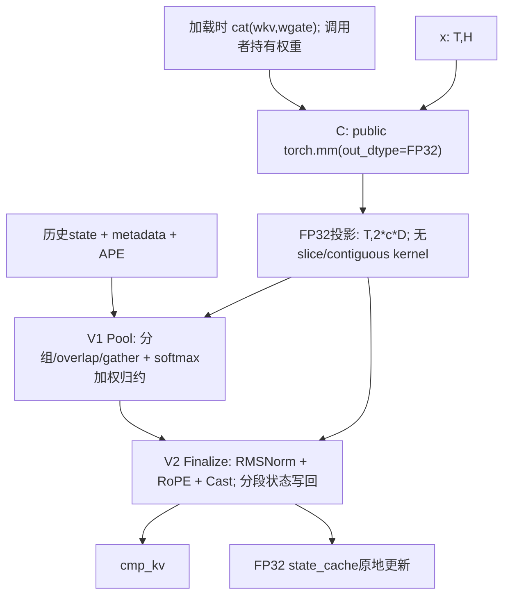

# A3 Compressor: Torch MatMul + Ascend C Vector

本实现面向模型适配初期的简单串行替代路径。C 只调用公开 Torch 接口，V 使用原创 Ascend C；没有阅读或复用原融合 Compressor 的计算 kernel、tiling、golden 或反汇编。

全126点的C/V诊断均已实测；Graph主性能表末列同时列出独立msprof的C/(C+V)，[分场景汇总和逐kernel分项](#逐kernel诊断与c比例)在后文。C比例的分母为同次profile中的C+V任务时间。

## 范围与接口

支持 A3、TND、连续 FP32 状态缓存、interleave RoPE64，以及 C4Li/C4A/C128A 三个业务族。支持 BF16/FP16；需要显式 cu_seqlens 和 start_pos，seqused 可以为空。BSH、ring cache、其他 ratio/coff 组合和省略 start_pos 的路径明确拒绝。没有修改现有融合算子或模型的默认 dispatch，没有 A5 或模型端到端性能结论。

```python
compressor_serial(
    x, wkv, wgate, state_cache, ape, norm_weight, rope_sin, rope_cos,
    state_block_table, cu_seqlens, seqused, start_pos,
    rope_head_dim, cmp_ratio, coff, norm_eps, rotary_mode, cache_mode,
    *, packed_weight=None,
) -> cmp_kv
```

| 参数 | 形状 / 类型 | 含义 |
| --- | --- | --- |
| x | [T,H], BF16/FP16 | 当前 hidden states；H 是 hidden width |
| wkv, wgate | 各 [c*D,H], 与 x 同类型 | KV/gate 投影权重 |
| state_cache | [blocks,block_size,2*c*D], FP32 | 原地更新；前半 KV，后半 gate+APE |
| ape | [r,c*D], FP32 | 按绝对位置模 r 取偏置 |
| norm_weight | [D], FP32 | 对 D 全维做 RMSNorm |
| rope_sin, rope_cos | [capacity,64], FP32 | 对输出最后64维做 interleave RoPE |
| table | [B,table_columns], INT32 | 物理页映射；0页不写回 |
| cu_seqlens | [B+1], INT32 | 每请求输入 token 前缀和 |
| seqused | [B], INT32 或 None | 有效 token 数；None 表示全部有效 |
| start_pos | [B], INT32 | 当前请求的绝对起始位置 |
| cmp_kv | [capacity,D], 与 x 同类型 | 有效行按请求连续排列，候选 padding 为0 |

令 r=cmp_ratio、c=coff。所有 Tensor 连续且同设备。当前上限 B=256、block_size=1..1024、H=1024..10240 且512对齐。调用者保证 metadata 值合法、页索引有效、并发写入位置没有冲突、输出容量足够。标准 TND 容量为 min(T,T//r+B)，实际分配沿用 rope_sin.shape[0]。静态属性检查不会通过 Tensor.item() 将设备数据同步回 CPU。

| 业务族 | r | c | D | 各投影输出 | 预拼后的单次矩阵乘 |
| --- | ---: | ---: | ---: | --- | --- |
| C4Li | 4 | 2 | 128 | [T,256] | [T,H] @ [H,512] -> FP32 |
| C4A | 4 | 2 | 512 | [T,1024] | [T,H] @ [H,2048] -> FP32 |
| C128A | 128 | 1 | 512 | [T,512] | [T,H] @ [H,1024] -> FP32 |

每请求有效输出数为 floor((start+used)/r)-floor(start/r)。c=1 使用当前 r 个位置；c=2 使用较早 r 个位置的前 D 通道和当前 r 个位置的后 D 通道。负位置的历史 KV 为0、score 为负无穷；历史 score 已含 APE，不能重复添加。逐通道沿 token 轴做 softmax 加权求和，再做 RMSNorm、RoPE；全部当前有效 token 的 FP32 KV 与 gate+APE 写回状态。

## C/V 流程与接入



预拼路径实测为一次 Torch MatMul 和两个 AIV-only kernel，同 stream 串行。没有手写 Cube kernel。未提供预拼权重时使用两次公开 torch.mm，功能同样测试；主性能表使用预拼路径。直接 BF16 mm 后转 float 不能恢复 FP32 状态精度，因此没有采用该近似。本机 trace 是 MatMulV3，没有锁定内部 CANN 版本。

- V1：ratio4 每任务完整 D 通道，ratio128 按64通道切分；按请求、来源、页和 APE 周期分段搬运，使用显式临时空间的 RA 归约。
- V2：输出任务做全 D RMSNorm 和向量 Gather RoPE；状态任务小 T 每任务1 token、大 T 每任务8 token。AIV 核数从平台查询，状态发布在 V1 历史读取完成后执行。
- metadata 查询利用每核 group/token 非降的任务顺序，缓存当前请求边界并向前推进；每次 kernel 调用重新初始化，Graph 重放可读取更新后的 metadata。没有新增 UB、schema 或逐 shape 查表。
- 两个 V 通过 op_host/op_kernel、ACLNN、EXEC_NPU_CMD、PrivateUse1/Meta 接入；通过显式 `_depends` 打包共享头，加入 A3 打包列表，根 CMake 在非 A3 排除其注册文件。
- 通用 adapter 的 IsOpInputBaseFormat 加 inline，修复新增 translation unit 后的重复定义；没有修改其他通用行为，没有新增运行时环境变量。

## 使用与复现

```python
from vllm_ascend.ops.compressor_serial import (
    compressor_serial,
    prepare_compressor_serial_weights,
)

packed = prepare_compressor_serial_weights(wkv, wgate)  # 权重加载后一次
out = compressor_serial(
    x, wkv, wgate, state_cache, ape, norm_weight, rope_sin, rope_cos,
    table, cu_seqlens, seqused, start_pos,
    64, ratio, coff, eps, 2, 1, packed_weight=packed,
)
```

预拼结果显式传入，不使用全局权重缓存。权重改变后必须重新准备。准备时间、一次性分配和额外权重存储不在稳态 Graph 指标中；BF16/FP16 预拼张量额外占 4*c*D*H 字节。投影、布局读取、归约、Norm/RoPE 和状态更新均在完整调用边界内。

标准 A3 仓库安装流程已接入两个算子的打包。新增组件的独立包构建已执行：

```bash
cd csrc
bash build.sh --pkg --soc=ascend910_93 --vendor_name=compressor_serial \
  --ops=compressor_serial_pool,compressor_serial_finalize -j8
```

唯一设备 UT 含原创 CPU FP64 参考与可选性能/profiler 入口：

```bash
pytest -q tests/ut/ops/test_compressor_serial.py
python tests/ut/ops/test_compressor_serial.py --benchmark --long-prefill --stress \
  --output=/tmp/compressor_serial_graph.json
msprof --task-time=l0 --ai-core=off --aicore-shape=on --export=on \
  --output=/tmp/compressor_serial_profile \
  python tests/ut/ops/test_compressor_serial.py \
  --profile candidate --case h4096-c4li-prefill8192 --long-prefill
```

本轮执行了新增 Vector 包构建、实际生产 C++ 注册/Meta 的构建与调用、单设备 UT 及独立采集；没有重建整个仓库或运行模型 serving。性能只对 BF16 与安装融合二进制比较，FP16 用独立参考验收。

## 本轮扩大范围与精度

2026-10-30 的正式候选保留一次公开 Torch mm 加两个 AIV-only 算子。新增优化为每核单调请求游标，避免每个压缩窗口/状态任务都从请求0重新扫描；没有把未证实收益的更多 tiling 分支加入产品。

| 项目 | 实际验收范围 |
| --- | --- |
| 模型宽度 | H4096/7168，来自公开 Flash/Pro 配置 |
| 业务族 | C4Li(r4,c2,D128)、C4A(r4,c2,D512)、C128A(r128,c1,D512) |
| Decode | B1/2/4/8/16/32/64/128/256，每请求1 token，start=r-1 |
| B1 Prefill | T64/128/256/512/1024/2048/4096/8192，start0 |
| 混合请求 | lengths=[1,255]；[1,31,127,865]；[1,7,31,63,127,255,511,1053] |
| 压力扩展 | B1、T16384，每个H/业务族各1点 |
| 性能输入 | BF16/TND，block_size128，连续FP32缓存，interleaved RoPE64 |

常规矩阵120点，保留原36点；另6个T16384压力点。混合用例包含较长历史和非均匀请求。T是本次调用的累计token数；这些是公开模型维度上的合法调度样本，没有宣称实际服务的batch/chunk分布或模型端到端收益。接口允许的全部H、B和block_size组合没有穷举。

最终单设备 UT **199 passed**：原109项，加30项B15/16/17/255/256请求索引检查、54项A3状态/页尾边界和6项Graph更新metadata检查。BF16/FP16、普通/预拼权重、空请求、部分seqused、0页、页置换、极负gate、padding/guard和非缓存输入保持均分别验收。业务和压力126点另做独立FP64参考、缓存副作用及Graph重放检查，全部通过。

- BF16输出：atol=rtol=2^-6，matched>=0.99，max_abs<=1。
- FP16输出：atol=rtol=2^-9，matched>=0.99，max_abs<=0.1。
- FP32状态：atol=2^-16、rtol=2^-10，matched>=0.99，max_abs<=0.01。
- 未更新缓存、guard、其他输入 exact；只将原融合输出有效前缀作基准。

CP10的真正负无穷掩码修复保持。安装融合BF16版本在三个合法partial-seqused多请求例中漏写缓存，候选遵循公开语义和独立参考；安装融合FP16分支缺少tilingKey163。因此FP16只有精度验收，没有融合速度结论。

## 按场景的 tiling 与选型

| 阶段 | 条件与策略 |
| --- | --- |
| C | 公开torch.mm；本环境trace为MatMulV3，内部tiling归Torch/CANN |
| V1 Pool，r4 | 每任务完整D通道，窗口8行 |
| V1 Pool，r128 | 每任务64通道，窗口128行；D512拆8个任务 |
| V2 Finalize | 输出任务处理完整D；状态任务T<=平台AIV核数时1token，否则最多8token |
| metadata | 每核非降group/token使用请求游标；不依赖预设的等长decode，不新增UB |

启动核数为平台AIV核数与任务数的较小值，两个V都使用TilingKey0。当前实测平台配置为20 AIC、40 AIV、UB196608字节，代码不写死这些核数。更多并行和更大tile都以受影响与保护范围的实测结果决定保留。

| 实验 | 改动 | 结论 |
| --- | --- | --- |
| CT01 | 跨APE周期合并状态搬运 | 精度通过，未证实稳定整体收益，单独方案不保留 |
| CT02B | 大B前缀索引和二分请求查找 | 大batch明显受益；最终用无额外UB游标替代，不叠加两套索引 |
| CT03 | 小groups拆通道增加任务 | 中等decode/prefill出现回退，拒绝 |
| CT04 | 所有场景按UB放大/缩小状态tile | 小prefill回退，拒绝 |
| CT06 / CT06R | 每核请求游标 | CT06旧二进制结果撤销；重编译CT06R验证收益 |
| CT07I | 前缀索引+仅长T增大状态tile | 未证实相比简单索引方案的稳定额外收益，不保留 |
| CT08D | 最小请求游标+正式共享头依赖 | 当前交付，199UT和126精度/Graph及逐任务诊断通过 |

共享头曾置于op目录外，增量构建复用了旧设备对象。现在共享头位于独立header-only目录，两处host CMake显式登记框架`_depends`。只修改共享头的预期编译失败探针已确认会使构建失效，恢复正确头后构建通过；正式产品不含该探针或内联调试副本。

## Graph主指标与workload排序

同一A3 Ascend910_9362，CANN9.2.0，Torch2.10.0+cpu，torch_npu2.10.0.post7.dev20261020，Bisheng clang15.0.5。最终采集与MLA分时运行，使用安装的完整Norm/RoPE融合二进制作基线。

每图捕获20次完整调用；NPU event包围一次Graph replay，间隔除20。两组各25次、去前5保留20，交替A/B顺序；速度取两组fused_mean/serial_mean较小值。下表耗时是两组均值的平均。权重准备在计时外，所有投影、布局、V和缓存更新在完整调用内。事件区间含Graph调度/提交空隙，不是纯kernel时间相加。

常规120点 **0.869x–3.003x**，**109/120>=1.2x，120/120>=0.8x**；压力6点 **0.811x起，4/6>=1.2x，6/6>=0.8x**。当前仍有13点低于1.2x，主要是C4Li长prefill/混合请求；全部如实保留。

新扩展范围中的旧CP10同环境基线只有114/120>=0.8x、94/120>=1.2x，最低0.489x；先前36点的结论不能外推到大batch。旧/新版是不同capture，表中CP10/当前只报告均值比，不冒充同次配对置信结论。各自对融合的两组保守速度单独保留于原始结果。压力6点没有重测CP10，缺失列为“—”。

workload主序为投影MACs=2*T*H*c*D（FLOPs=2*MACs），再按窗口和状态量排序。窗口元素=有效压缩行*r*c*D，含缺失历史的逻辑位置，不是实际HBM字节或总指令量。同T256的C128A，B256 decode有256个窗口，B1 prefill只有2个，窗口量相差128倍；因此同MACs不保证完整耗时相同。

| 案例 | C GFLOPs | 窗口元素M | 融合Graph us | CP10 Graph us | 当前Graph us | 速度(融合/当前) | CP10/当前均值比 | C/(C+V) |
| --- | ---: | ---: | ---: | ---: | ---: | ---: | ---: | ---: |
| h4096-c4li-decode1 | 0.004194 | 0.001024 | 39.146 | 14.253 | 14.222 | 2.751x | 1.002x | 67.8% |
| h7168-c4li-decode1 | 0.007340 | 0.001024 | 43.808 | 16.167 | 15.957 | 2.744x | 1.013x | 73.1% |
| h4096-c4li-decode2 | 0.008389 | 0.002048 | 43.970 | 14.944 | 14.672 | 2.994x | 1.019x | 67.9% |
| h4096-c128a-decode1 | 0.008389 | 0.065536 | 44.135 | 17.750 | 17.592 | 2.507x | 1.009x | 63.5% |
| h7168-c4li-decode2 | 0.014680 | 0.002048 | 47.718 | 16.839 | 16.693 | 2.856x | 1.009x | 70.2% |
| h7168-c128a-decode1 | 0.014680 | 0.065536 | 46.397 | 20.718 | 20.461 | 2.267x | 1.013x | 67.8% |
| h4096-c4a-decode1 | 0.016777 | 0.004096 | 45.322 | 19.664 | 19.213 | 2.356x | 1.023x | 74.8% |
| h4096-c4li-decode4 | 0.016777 | 0.004096 | 44.653 | 15.040 | 14.849 | 3.003x | 1.013x | 63.9% |
| h4096-c128a-decode2 | 0.016777 | 0.131072 | 45.664 | 19.045 | 18.967 | 2.405x | 1.004x | 58.9% |
| h7168-c4a-decode1 | 0.029360 | 0.004096 | 51.212 | 24.258 | 24.497 | 2.090x | 0.990x | 79.3% |
| h7168-c4li-decode4 | 0.029360 | 0.004096 | 48.491 | 16.814 | 16.694 | 2.898x | 1.007x | 66.7% |
| h7168-c128a-decode2 | 0.029360 | 0.131072 | 49.197 | 22.171 | 21.555 | 2.282x | 1.029x | 63.3% |
| h4096-c4a-decode2 | 0.033554 | 0.008192 | 47.559 | 19.921 | 19.803 | 2.398x | 1.006x | 72.8% |
| h4096-c4li-decode8 | 0.033554 | 0.008192 | 46.042 | 16.617 | 16.254 | 2.830x | 1.022x | 57.0% |
| h4096-c128a-decode4 | 0.033554 | 0.262144 | 46.284 | 21.939 | 21.293 | 2.168x | 1.030x | 50.3% |
| h7168-c4a-decode2 | 0.058720 | 0.008192 | 53.863 | 24.753 | 24.668 | 2.176x | 1.003x | 77.6% |
| h7168-c4li-decode8 | 0.058720 | 0.008192 | 51.196 | 18.339 | 18.065 | 2.833x | 1.015x | 60.6% |
| h7168-c128a-decode4 | 0.058720 | 0.262144 | 49.977 | 24.561 | 24.203 | 2.065x | 1.015x | 49.1% |
| h4096-c4a-decode4 | 0.067109 | 0.016384 | 46.198 | 20.041 | 19.917 | 2.318x | 1.006x | 69.8% |
| h4096-c4li-decode16 | 0.067109 | 0.016384 | 47.955 | 20.092 | 19.708 | 2.431x | 1.019x | 47.9% |
| h4096-c128a-decode8 | 0.067109 | 0.524288 | 48.581 | 26.463 | 26.062 | 1.864x | 1.015x | 42.9% |
| h7168-c4a-decode4 | 0.117441 | 0.016384 | 51.404 | 24.995 | 24.846 | 2.067x | 1.006x | 74.7% |
| h7168-c4li-decode16 | 0.117441 | 0.016384 | 51.742 | 22.390 | 21.859 | 2.365x | 1.024x | 52.3% |
| h7168-c128a-decode8 | 0.117441 | 0.524288 | 51.872 | 29.156 | 29.025 | 1.786x | 1.005x | 47.4% |
| h4096-c4a-decode8 | 0.134218 | 0.032768 | 47.361 | 21.628 | 21.604 | 2.191x | 1.001x | 62.7% |
| h4096-c4li-decode32 | 0.134218 | 0.032768 | 55.443 | 25.993 | 26.059 | 2.127x | 0.997x | 40.9% |
| h4096-c128a-decode16 | 0.134218 | 1.048576 | 54.456 | 34.540 | 33.435 | 1.629x | 1.033x | 32.7% |
| h7168-c4a-decode8 | 0.234881 | 0.032768 | 53.832 | 26.645 | 26.560 | 2.026x | 1.003x | 69.5% |
| h7168-c4li-decode32 | 0.234881 | 0.032768 | 59.886 | 29.747 | 27.920 | 2.144x | 1.065x | 44.6% |
| h7168-c128a-decode16 | 0.234881 | 1.048576 | 58.431 | 37.485 | 36.498 | 1.601x | 1.027x | 39.5% |
| h4096-c4li-prefill64 | 0.268435 | 0.016384 | 47.926 | 21.389 | 21.721 | 2.204x | 0.985x | 53.9% |
| h4096-c4a-decode16 | 0.268435 | 0.065536 | 51.305 | 26.022 | 25.224 | 2.033x | 1.032x | 55.7% |
| h4096-c4li-decode64 | 0.268435 | 0.065536 | 63.433 | 49.141 | 33.702 | 1.879x | 1.458x | 36.0% |
| h4096-c128a-decode32 | 0.268435 | 2.097152 | 73.567 | 49.235 | 45.682 | 1.610x | 1.078x | 26.4% |
| h7168-c4li-prefill64 | 0.469762 | 0.016384 | 53.882 | 24.633 | 24.702 | 2.181x | 0.997x | 58.9% |
| h7168-c4a-decode16 | 0.469762 | 0.065536 | 56.381 | 30.444 | 30.293 | 1.861x | 1.005x | 61.5% |
| h7168-c4li-decode64 | 0.469762 | 0.065536 | 68.712 | 52.204 | 37.165 | 1.848x | 1.405x | 40.6% |
| h7168-c128a-decode32 | 0.469762 | 2.097152 | 77.175 | 52.633 | 48.512 | 1.591x | 1.085x | 32.2% |
| h4096-c128a-prefill64 | 0.536871 | 0.000000 | 31.448 | 18.929 | 19.426 | 1.584x | 0.974x | 69.1% |
| h4096-c4li-prefill128 | 0.536871 | 0.032768 | 55.668 | 26.295 | 26.364 | 2.111x | 0.997x | 45.2% |
| h4096-c4a-decode32 | 0.536871 | 0.131072 | 55.930 | 32.773 | 31.734 | 1.762x | 1.033x | 44.9% |
| h4096-c4li-decode128 | 0.536871 | 0.131072 | 79.389 | 78.749 | 42.939 | 1.849x | 1.834x | 33.7% |
| h4096-c128a-decode64 | 0.536871 | 4.194304 | 99.840 | 98.423 | 69.242 | 1.417x | 1.421x | 21.7% |
| h7168-c128a-prefill64 | 0.939524 | 0.000000 | 36.441 | 22.915 | 22.617 | 1.611x | 1.013x | 73.6% |
| h7168-c4li-prefill128 | 0.939524 | 0.032768 | 64.424 | 30.360 | 30.374 | 2.119x | 1.000x | 50.9% |
| h7168-c4a-decode32 | 0.939524 | 0.131072 | 63.887 | 37.409 | 37.273 | 1.714x | 1.004x | 54.1% |
| h7168-c4li-decode128 | 0.939524 | 0.131072 | 85.505 | 81.989 | 46.789 | 1.827x | 1.752x | 38.9% |
| h7168-c128a-decode64 | 0.939524 | 4.194304 | 107.792 | 101.882 | 72.629 | 1.484x | 1.403x | 25.6% |
| h4096-c128a-prefill128 | 1.073742 | 0.065536 | 50.096 | 27.073 | 27.126 | 1.846x | 0.998x | 62.2% |
| h4096-c4a-prefill64 | 1.073742 | 0.065536 | 52.143 | 28.455 | 28.503 | 1.829x | 0.998x | 57.7% |
| h4096-c4li-mixed2-t256 | 1.073742 | 0.065536 | 67.484 | 35.158 | 34.702 | 1.943x | 1.013x | 45.8% |
| h4096-c4li-prefill256 | 1.073742 | 0.065536 | 56.019 | 34.313 | 33.250 | 1.685x | 1.032x | 46.3% |
| h4096-c4a-decode64 | 1.073742 | 0.262144 | 66.665 | 57.157 | 41.260 | 1.616x | 1.385x | 42.9% |
| h4096-c4li-decode256 | 1.073742 | 0.262144 | 115.446 | 151.805 | 65.084 | 1.770x | 2.332x | 27.7% |
| h4096-c128a-decode128 | 1.073742 | 8.388608 | 158.395 | 207.443 | 115.788 | 1.368x | 1.792x | 18.9% |
| h7168-c128a-prefill128 | 1.879048 | 0.065536 | 54.866 | 33.655 | 33.340 | 1.645x | 1.009x | 68.9% |
| h7168-c4a-prefill64 | 1.879048 | 0.065536 | 58.141 | 34.055 | 33.635 | 1.728x | 1.012x | 65.3% |
| h7168-c4li-mixed2-t256 | 1.879048 | 0.065536 | 83.480 | 41.625 | 40.481 | 2.062x | 1.028x | 53.4% |
| h7168-c4li-prefill256 | 1.879048 | 0.065536 | 63.041 | 41.036 | 39.999 | 1.575x | 1.026x | 53.1% |
| h7168-c4a-decode64 | 1.879048 | 0.262144 | 73.409 | 63.537 | 46.832 | 1.567x | 1.357x | 49.4% |
| h7168-c4li-decode256 | 1.879048 | 0.262144 | 123.801 | 157.916 | 70.813 | 1.748x | 2.230x | 33.8% |
| h7168-c128a-decode128 | 1.879048 | 8.388608 | 170.427 | 214.680 | 124.243 | 1.371x | 1.728x | 23.7% |
| h4096-c128a-mixed2-t256 | 2.147484 | 0.131072 | 63.532 | 35.162 | 35.493 | 1.790x | 0.991x | 56.3% |
| h4096-c128a-prefill256 | 2.147484 | 0.131072 | 59.228 | 33.565 | 33.197 | 1.783x | 1.011x | 58.2% |
| h4096-c4a-prefill128 | 2.147484 | 0.131072 | 58.615 | 36.927 | 36.322 | 1.612x | 1.017x | 52.7% |
| h4096-c4li-prefill512 | 2.147484 | 0.131072 | 84.766 | 44.978 | 43.640 | 1.942x | 1.031x | 44.8% |
| h4096-c4a-decode128 | 2.147484 | 0.524288 | 89.798 | 89.541 | 54.453 | 1.649x | 1.644x | 37.3% |
| h4096-c128a-decode256 | 2.147484 | 16.777216 | 274.001 | 542.581 | 221.314 | 1.238x | 2.452x | 12.0% |
| h7168-c128a-mixed2-t256 | 3.758096 | 0.131072 | 80.167 | 42.081 | 42.058 | 1.905x | 1.001x | 62.1% |
| h7168-c128a-prefill256 | 3.758096 | 0.131072 | 71.341 | 41.393 | 41.146 | 1.734x | 1.006x | 63.9% |
| h7168-c4a-prefill128 | 3.758096 | 0.131072 | 68.333 | 43.557 | 43.219 | 1.580x | 1.008x | 58.6% |
| h7168-c4li-prefill512 | 3.758096 | 0.131072 | 99.294 | 51.210 | 50.291 | 1.974x | 1.018x | 51.5% |
| h7168-c4a-decode128 | 3.758096 | 0.524288 | 99.555 | 96.048 | 61.963 | 1.606x | 1.550x | 43.3% |
| h7168-c128a-decode256 | 3.758096 | 16.777216 | 296.282 | 554.246 | 230.579 | 1.285x | 2.404x | 15.8% |
| h4096-c128a-prefill512 | 4.294967 | 0.262144 | 81.634 | 44.103 | 44.722 | 1.824x | 0.986x | 55.6% |
| h4096-c4a-mixed2-t256 | 4.294967 | 0.262144 | 68.927 | 50.784 | 50.976 | 1.352x | 0.996x | 54.7% |
| h4096-c4a-prefill256 | 4.294967 | 0.262144 | 90.319 | 49.376 | 49.587 | 1.821x | 0.996x | 54.7% |
| h4096-c4li-prefill1024 | 4.294967 | 0.262144 | 145.885 | 70.009 | 68.440 | 2.131x | 1.023x | 43.8% |
| h4096-c4li-ragged4-t1024 | 4.294967 | 0.262144 | 73.748 | 73.506 | 70.024 | 1.053x | 1.050x | 42.3% |
| h4096-c4a-decode256 | 4.294967 | 1.048576 | 140.547 | 170.142 | 84.023 | 1.672x | 2.025x | 37.0% |
| h7168-c128a-prefill512 | 7.516193 | 0.262144 | 107.813 | 57.989 | 58.046 | 1.857x | 0.999x | 64.7% |
| h7168-c4a-mixed2-t256 | 7.516193 | 0.262144 | 87.595 | 63.456 | 63.716 | 1.374x | 0.996x | 62.4% |
| h7168-c4a-prefill256 | 7.516193 | 0.262144 | 110.617 | 62.625 | 62.252 | 1.777x | 1.006x | 62.5% |
| h7168-c4li-prefill1024 | 7.516193 | 0.262144 | 179.342 | 82.600 | 80.772 | 2.219x | 1.023x | 51.9% |
| h7168-c4li-ragged4-t1024 | 7.516193 | 0.262144 | 90.262 | 87.648 | 84.716 | 1.065x | 1.035x | 50.3% |
| h7168-c4a-decode256 | 7.516193 | 1.048576 | 161.588 | 182.976 | 96.742 | 1.670x | 1.891x | 45.0% |
| h4096-c4li-ragged8-t2048 | 8.589935 | 0.522240 | 113.034 | 128.737 | 120.904 | 0.935x | 1.065x | 39.3% |
| h4096-c128a-prefill1024 | 8.589935 | 0.524288 | 93.869 | 72.704 | 74.060 | 1.267x | 0.982x | 65.0% |
| h4096-c128a-ragged4-t1024 | 8.589935 | 0.524288 | 106.514 | 74.391 | 72.195 | 1.475x | 1.030x | 64.6% |
| h4096-c4a-prefill512 | 8.589935 | 0.524288 | 112.642 | 77.925 | 77.343 | 1.456x | 1.008x | 59.5% |
| h4096-c4li-prefill2048 | 8.589935 | 0.524288 | 112.608 | 126.228 | 117.426 | 0.958x | 1.075x | 41.4% |
| h7168-c4li-ragged8-t2048 | 15.032386 | 0.522240 | 146.631 | 157.425 | 150.656 | 0.973x | 1.045x | 50.6% |
| h7168-c128a-prefill1024 | 15.032386 | 0.524288 | 128.834 | 103.858 | 103.165 | 1.248x | 1.007x | 74.6% |
| h7168-c128a-ragged4-t1024 | 15.032386 | 0.524288 | 150.230 | 104.665 | 103.271 | 1.454x | 1.013x | 74.4% |
| h7168-c4a-prefill512 | 15.032386 | 0.524288 | 149.242 | 108.500 | 108.645 | 1.373x | 0.999x | 69.9% |
| h7168-c4li-prefill2048 | 15.032386 | 0.524288 | 148.540 | 152.096 | 147.305 | 1.008x | 1.033x | 52.5% |
| h4096-c128a-ragged8-t2048 | 17.179869 | 0.983040 | 162.251 | 124.427 | 123.951 | 1.309x | 1.004x | 67.7% |
| h4096-c128a-prefill2048 | 17.179869 | 1.048576 | 150.968 | 122.517 | 120.796 | 1.250x | 1.014x | 70.0% |
| h4096-c4a-prefill1024 | 17.179869 | 1.048576 | 199.780 | 135.230 | 135.429 | 1.475x | 0.999x | 64.7% |
| h4096-c4a-ragged4-t1024 | 17.179869 | 1.048576 | 230.150 | 139.030 | 137.931 | 1.668x | 1.008x | 63.4% |
| h4096-c4li-prefill4096 | 17.179869 | 1.048576 | 207.159 | 227.806 | 217.833 | 0.951x | 1.046x | 39.3% |
| h7168-c128a-ragged8-t2048 | 30.064771 | 0.983040 | 232.450 | 184.532 | 185.303 | 1.254x | 0.996x | 78.0% |
| h7168-c128a-prefill2048 | 30.064771 | 1.048576 | 219.444 | 183.306 | 181.420 | 1.209x | 1.010x | 80.2% |
| h7168-c4a-prefill1024 | 30.064771 | 1.048576 | 267.079 | 199.473 | 198.527 | 1.345x | 1.005x | 75.4% |
| h7168-c4a-ragged4-t1024 | 30.064771 | 1.048576 | 308.424 | 202.996 | 201.811 | 1.528x | 1.006x | 74.7% |
| h7168-c4li-prefill4096 | 30.064771 | 1.048576 | 271.117 | 289.474 | 278.985 | 0.972x | 1.038x | 52.9% |
| h4096-c4a-ragged8-t2048 | 34.359738 | 2.088960 | 400.534 | 238.398 | 238.309 | 1.681x | 1.000x | 64.1% |
| h4096-c128a-prefill4096 | 34.359738 | 2.097152 | 260.913 | 201.678 | 204.254 | 1.277x | 0.987x | 73.3% |
| h4096-c4a-prefill2048 | 34.359738 | 2.097152 | 375.439 | 232.075 | 231.299 | 1.623x | 1.003x | 65.4% |
| h4096-c4li-prefill8192 | 34.359738 | 2.097152 | 358.524 | 431.356 | 411.967 | 0.869x | 1.047x | 38.0% |
| h7168-c4a-ragged8-t2048 | 60.129542 | 2.088960 | 548.128 | 350.477 | 354.702 | 1.545x | 0.988x | 75.4% |
| h7168-c128a-prefill4096 | 60.129542 | 2.097152 | 412.355 | 343.022 | 350.622 | 1.176x | 0.978x | 84.3% |
| h7168-c4a-prefill2048 | 60.129542 | 2.097152 | 514.076 | 343.072 | 344.672 | 1.491x | 0.995x | 78.7% |
| h7168-c4li-prefill8192 | 60.129542 | 2.097152 | 508.838 | 583.403 | 561.738 | 0.905x | 1.039x | 53.8% |
| h4096-c128a-prefill8192 | 68.719477 | 4.194304 | 521.479 | 409.612 | 408.470 | 1.276x | 1.003x | 77.6% |
| h4096-c4a-prefill4096 | 68.719477 | 4.194304 | 735.070 | 440.928 | 443.831 | 1.656x | 0.993x | 67.5% |
| h4096-c4li-prefill16384 | 68.719477 | 4.194304 | 688.824 | — | 848.789 | 0.811x | — | 40.6% |
| h7168-c128a-prefill8192 | 120.259084 | 4.194304 | 906.707 | 668.483 | 669.862 | 1.354x | 0.998x | 85.2% |
| h7168-c4a-prefill4096 | 120.259084 | 4.194304 | 1010.633 | 691.163 | 714.986 | 1.413x | 0.967x | 80.0% |
| h7168-c4li-prefill16384 | 120.259084 | 4.194304 | 990.405 | — | 1111.786 | 0.891x | — | 53.8% |
| h4096-c128a-prefill16384 | 137.438953 | 8.388608 | 1102.155 | — | 838.841 | 1.314x | — | 78.4% |
| h4096-c4a-prefill8192 | 137.438953 | 8.388608 | 1459.872 | 920.307 | 900.987 | 1.620x | 1.021x | 69.9% |
| h7168-c128a-prefill16384 | 240.518169 | 8.388608 | 1906.471 | — | 1341.140 | 1.422x | — | 85.9% |
| h7168-c4a-prefill8192 | 240.518169 | 8.388608 | 2028.806 | 1351.836 | 1350.498 | 1.502x | 1.001x | 79.4% |
| h4096-c4a-prefill16384 | 274.877907 | 16.777216 | 2953.467 | — | 1778.032 | 1.661x | — | 67.9% |
| h7168-c4a-prefill16384 | 481.036337 | 16.777216 | 4039.717 | — | 2732.315 | 1.478x | — | 79.0% |

## 逐kernel诊断与C比例

全126点独立full msprof，关闭AI Core计数，仅保留task时间/shape。每shape5次eager warmup及25次完整Graph调用，取最后20次。运行时复用ModelID和缓存首shape，因此按已同步的有序epoch、5次前置MatMul shape和严格25组完整任务共同校验；同一MatMul shape的不同batch分布不会合并。

每调用都实际观察到MatMul+Pool+Finalize共3任务。C是整个Torch矩阵乘任务duration，C/(C+V)不是Cube管线忙碌率；这些受profiler影响的时间与独立Graph结果分栏，不混算。

### 覆盖、定义与场景趋势

全126个Graph案例均有对应的独立msprof分项记录，缺失0点；每点保留20个完整串行序列，共2520个调用、7560个任务。C为公开Torch MatMul任务的完整duration；V=V1 Pool+V2 Finalize。表中C/(C+V)按保留序列的分项均值计算，V/(C+V)=1-C/(C+V)，时间单位均为微秒。

下表给出各组已测shape的占比范围；每组decode 9点、prefill 8点、mixed/ragged 3点、T16384压力1点。范围保留shape差异，没有将不同workload平均成一个模型占比。

| 业务族 | H | Decode C/(C+V) | Prefill C/(C+V) | Mixed/ragged C/(C+V) | T16384 C/(C+V) |
| --- | ---: | ---: | ---: | ---: | ---: |
| C4Li | 4096 | 27.7%–67.9% | 38.0%–53.9% | 39.3%–45.8% | 40.6% |
| C4Li | 7168 | 33.8%–73.1% | 50.9%–58.9% | 50.3%–53.4% | 53.8% |
| C128A | 4096 | 12.0%–63.5% | 55.6%–77.6% | 56.3%–67.7% | 78.4% |
| C128A | 7168 | 15.8%–67.8% | 63.9%–85.2% | 62.1%–78.0% | 85.9% |
| C4A | 4096 | 37.0%–74.8% | 52.7%–69.9% | 54.7%–64.1% | 67.9% |
| C4A | 7168 | 43.3%–79.3% | 58.6%–80.0% | 62.4%–75.4% | 79.0% |

例如H4096/C128A的decode从B1到B256，C占比从63.5%降到12.0%；H7168/C128A的prefill从T128到T16384，C占比从68.9%升到85.9%。H4096/C4Li的T8192为38.0%，对应V合计269.285us；同为长prefill，算子族不同会改变C/V重心。

这些分项来自2026-10-30的CT08D采集，Graph列保持原采集结果。msprof分项与Graph是独立测量，profiler会扰动执行时间；Graph调度空隙不进入分项分母，因此不使用C/Graph或Graph-C推算占比。占比用于判断任务时间构成，不代表Cube硬件利用率。

### 按workload升序的完整逐kernel表

| 案例 | C us | V1 Pool us | V2 Finalize us | V合计 us | kernel相加 us | C/(C+V) | V/(C+V) |
| --- | ---: | ---: | ---: | ---: | ---: | ---: | ---: |
| h4096-c4li-decode1 | 12.597 | 3.020 | 2.974 | 5.994 | 18.591 | 67.8% | 32.2% |
| h7168-c4li-decode1 | 14.363 | 2.755 | 2.537 | 5.292 | 19.655 | 73.1% | 26.9% |
| h4096-c4li-decode2 | 12.679 | 3.064 | 2.943 | 6.007 | 18.686 | 67.9% | 32.1% |
| h4096-c128a-decode1 | 14.208 | 5.570 | 2.583 | 8.153 | 22.361 | 63.5% | 36.5% |
| h7168-c4li-decode2 | 14.334 | 3.086 | 2.988 | 6.074 | 20.408 | 70.2% | 29.8% |
| h7168-c128a-decode1 | 17.182 | 5.562 | 2.594 | 8.156 | 25.338 | 67.8% | 32.2% |
| h4096-c4a-decode1 | 17.631 | 3.318 | 2.618 | 5.936 | 23.567 | 74.8% | 25.2% |
| h4096-c4li-decode4 | 12.689 | 3.526 | 3.640 | 7.166 | 19.855 | 63.9% | 36.1% |
| h4096-c128a-decode2 | 14.236 | 7.005 | 2.945 | 9.950 | 24.186 | 58.9% | 41.1% |
| h7168-c4a-decode1 | 22.406 | 3.277 | 2.589 | 5.866 | 28.272 | 79.3% | 20.7% |
| h7168-c4li-decode4 | 14.451 | 3.572 | 3.656 | 7.228 | 21.679 | 66.7% | 33.3% |
| h7168-c128a-decode2 | 17.168 | 7.018 | 2.957 | 9.975 | 27.143 | 63.3% | 36.7% |
| h4096-c4a-decode2 | 17.468 | 3.558 | 2.969 | 6.527 | 23.995 | 72.8% | 27.2% |
| h4096-c4li-decode8 | 12.610 | 4.495 | 5.037 | 9.532 | 22.142 | 57.0% | 43.0% |
| h4096-c128a-decode4 | 14.300 | 10.467 | 3.652 | 14.119 | 28.419 | 50.3% | 49.7% |
| h7168-c4a-decode2 | 22.396 | 3.484 | 2.991 | 6.475 | 28.871 | 77.6% | 22.4% |
| h7168-c4li-decode8 | 14.587 | 4.420 | 5.058 | 9.478 | 24.065 | 60.6% | 39.4% |
| h7168-c128a-decode4 | 17.183 | 14.152 | 3.693 | 17.845 | 35.028 | 49.1% | 50.9% |
| h4096-c4a-decode4 | 17.722 | 3.931 | 3.748 | 7.679 | 25.401 | 69.8% | 30.2% |
| h4096-c4li-decode16 | 12.892 | 6.221 | 7.783 | 14.004 | 26.896 | 47.9% | 52.1% |
| h4096-c128a-decode8 | 14.250 | 13.915 | 5.029 | 18.944 | 33.194 | 42.9% | 57.1% |
| h7168-c4a-decode4 | 22.437 | 3.927 | 3.676 | 7.603 | 30.040 | 74.7% | 25.3% |
| h7168-c4li-decode16 | 15.183 | 6.113 | 7.707 | 13.820 | 29.003 | 52.3% | 47.7% |
| h7168-c128a-decode8 | 17.130 | 14.001 | 5.045 | 19.046 | 36.176 | 47.4% | 52.6% |
| h4096-c4a-decode8 | 17.564 | 4.903 | 5.565 | 10.468 | 28.032 | 62.7% | 37.3% |
| h4096-c4li-decode32 | 13.756 | 9.467 | 10.427 | 19.894 | 33.650 | 40.9% | 59.1% |
| h4096-c128a-decode16 | 14.469 | 21.932 | 7.844 | 29.776 | 44.245 | 32.7% | 67.3% |
| h7168-c4a-decode8 | 22.475 | 4.826 | 5.051 | 9.877 | 32.352 | 69.5% | 30.5% |
| h7168-c4li-decode32 | 16.171 | 9.488 | 10.598 | 20.086 | 36.257 | 44.6% | 55.4% |
| h7168-c128a-decode16 | 17.330 | 18.781 | 7.724 | 26.505 | 43.835 | 39.5% | 60.5% |
| h4096-c4li-prefill64 | 14.666 | 5.717 | 6.846 | 12.563 | 27.229 | 53.9% | 46.1% |
| h4096-c4a-decode16 | 17.852 | 6.554 | 7.630 | 14.184 | 32.036 | 55.7% | 44.3% |
| h4096-c4li-decode64 | 14.769 | 12.981 | 13.309 | 26.290 | 41.059 | 36.0% | 64.0% |
| h4096-c128a-decode32 | 14.806 | 30.855 | 10.424 | 41.279 | 56.085 | 26.4% | 73.6% |
| h7168-c4li-prefill64 | 18.000 | 5.680 | 6.903 | 12.583 | 30.583 | 58.9% | 41.1% |
| h7168-c4a-decode16 | 22.707 | 6.481 | 7.751 | 14.232 | 36.939 | 61.5% | 38.5% |
| h7168-c4li-decode64 | 17.896 | 13.012 | 13.187 | 26.199 | 44.095 | 40.6% | 59.4% |
| h7168-c128a-decode32 | 18.018 | 27.412 | 10.602 | 38.014 | 56.032 | 32.2% | 67.8% |
| h4096-c128a-prefill64 | 16.028 | 2.949 | 4.227 | 7.176 | 23.204 | 69.1% | 30.9% |
| h4096-c4li-prefill128 | 16.009 | 9.613 | 9.761 | 19.374 | 35.383 | 45.2% | 54.8% |
| h4096-c4a-decode32 | 18.891 | 9.912 | 13.314 | 23.226 | 42.117 | 44.9% | 55.1% |
| h4096-c4li-decode128 | 16.035 | 16.936 | 14.634 | 31.570 | 47.605 | 33.7% | 66.3% |
| h4096-c128a-decode64 | 16.035 | 44.613 | 13.186 | 57.799 | 73.834 | 21.7% | 78.3% |
| h7168-c128a-prefill64 | 20.154 | 3.001 | 4.219 | 7.220 | 27.374 | 73.6% | 26.4% |
| h7168-c4li-prefill128 | 20.191 | 9.606 | 9.835 | 19.441 | 39.632 | 50.9% | 49.1% |
| h7168-c4a-decode32 | 23.912 | 9.803 | 10.463 | 20.266 | 44.178 | 54.1% | 45.9% |
| h7168-c4li-decode128 | 20.171 | 17.009 | 14.620 | 31.629 | 51.800 | 38.9% | 61.1% |
| h7168-c128a-decode64 | 20.072 | 45.218 | 13.155 | 58.373 | 78.445 | 25.6% | 74.4% |
| h4096-c128a-prefill128 | 19.722 | 6.279 | 5.702 | 11.981 | 31.703 | 62.2% | 37.8% |
| h4096-c4a-prefill64 | 20.218 | 6.184 | 8.650 | 14.834 | 35.052 | 57.7% | 42.3% |
| h4096-c4li-mixed2-t256 | 19.621 | 11.801 | 11.414 | 23.215 | 42.836 | 45.8% | 54.2% |
| h4096-c4li-prefill256 | 19.605 | 11.758 | 10.957 | 22.715 | 42.320 | 46.3% | 53.7% |
| h4096-c4a-decode64 | 20.404 | 13.635 | 13.542 | 27.177 | 47.581 | 42.9% | 57.1% |
| h4096-c4li-decode256 | 19.661 | 27.467 | 23.866 | 51.333 | 70.994 | 27.7% | 72.3% |
| h4096-c128a-decode128 | 22.544 | 81.734 | 15.083 | 96.817 | 119.361 | 18.9% | 81.1% |
| h7168-c128a-prefill128 | 26.297 | 6.203 | 5.693 | 11.896 | 38.193 | 68.9% | 31.1% |
| h7168-c4a-prefill64 | 26.139 | 6.218 | 7.643 | 13.861 | 40.000 | 65.3% | 34.7% |
| h7168-c4li-mixed2-t256 | 26.313 | 11.929 | 11.001 | 22.930 | 49.243 | 53.4% | 46.6% |
| h7168-c4li-prefill256 | 26.347 | 11.955 | 11.309 | 23.264 | 49.611 | 53.1% | 46.9% |
| h7168-c4a-decode64 | 26.204 | 13.550 | 13.264 | 26.814 | 53.018 | 49.4% | 50.6% |
| h7168-c4li-decode256 | 26.340 | 27.691 | 23.827 | 51.518 | 77.858 | 33.8% | 66.2% |
| h7168-c128a-decode128 | 30.206 | 81.921 | 15.063 | 96.984 | 127.190 | 23.7% | 76.3% |
| h4096-c128a-mixed2-t256 | 24.915 | 8.934 | 10.407 | 19.341 | 44.256 | 56.3% | 43.7% |
| h4096-c128a-prefill256 | 24.901 | 7.772 | 10.104 | 17.876 | 42.777 | 58.2% | 41.8% |
| h4096-c4a-prefill128 | 24.918 | 9.732 | 12.633 | 22.365 | 47.283 | 52.7% | 47.3% |
| h4096-c4li-prefill512 | 22.331 | 14.077 | 13.485 | 27.562 | 49.893 | 44.8% | 55.2% |
| h4096-c4a-decode128 | 24.861 | 24.246 | 17.629 | 41.875 | 66.736 | 37.3% | 62.7% |
| h4096-c128a-decode256 | 27.467 | 175.551 | 25.975 | 201.526 | 228.993 | 12.0% | 88.0% |
| h7168-c128a-mixed2-t256 | 31.645 | 8.951 | 10.402 | 19.353 | 50.998 | 62.1% | 37.9% |
| h7168-c128a-prefill256 | 31.568 | 7.748 | 10.109 | 17.857 | 49.425 | 63.9% | 36.1% |
| h7168-c4a-prefill128 | 31.729 | 9.744 | 12.654 | 22.398 | 54.127 | 58.6% | 41.4% |
| h7168-c4li-prefill512 | 29.929 | 14.303 | 13.888 | 28.191 | 58.120 | 51.5% | 48.5% |
| h7168-c4a-decode128 | 31.803 | 23.952 | 17.691 | 41.643 | 73.446 | 43.3% | 56.7% |
| h7168-c128a-decode256 | 37.935 | 176.838 | 26.074 | 202.912 | 240.847 | 15.8% | 84.2% |
| h4096-c128a-prefill512 | 31.038 | 12.177 | 12.601 | 24.778 | 55.816 | 55.6% | 44.4% |
| h4096-c4a-mixed2-t256 | 33.869 | 12.487 | 15.550 | 28.037 | 61.906 | 54.7% | 45.3% |
| h4096-c4a-prefill256 | 33.790 | 12.774 | 15.193 | 27.967 | 61.757 | 54.7% | 45.3% |
| h4096-c4li-prefill1024 | 32.583 | 18.773 | 23.014 | 41.787 | 74.370 | 43.8% | 56.2% |
| h4096-c4li-ragged4-t1024 | 32.687 | 19.295 | 25.348 | 44.643 | 77.330 | 42.3% | 57.7% |
| h4096-c4a-decode256 | 33.679 | 28.920 | 28.321 | 57.241 | 90.920 | 37.0% | 63.0% |
| h7168-c128a-prefill512 | 45.277 | 12.134 | 12.622 | 24.756 | 70.033 | 64.7% | 35.3% |
| h7168-c4a-mixed2-t256 | 47.076 | 12.658 | 15.732 | 28.390 | 75.466 | 62.4% | 37.6% |
| h7168-c4a-prefill256 | 46.762 | 12.530 | 15.574 | 28.104 | 74.866 | 62.5% | 37.5% |
| h7168-c4li-prefill1024 | 45.273 | 18.943 | 23.071 | 42.014 | 87.287 | 51.9% | 48.1% |
| h7168-c4li-ragged4-t1024 | 45.229 | 19.534 | 25.178 | 44.712 | 89.941 | 50.3% | 49.7% |
| h7168-c4a-decode256 | 46.894 | 28.962 | 28.443 | 57.405 | 104.299 | 45.0% | 55.0% |
| h4096-c4li-ragged8-t2048 | 51.523 | 29.910 | 49.534 | 79.444 | 130.967 | 39.3% | 60.7% |
| h4096-c128a-prefill1024 | 53.088 | 14.095 | 14.528 | 28.623 | 81.711 | 65.0% | 35.0% |
| h4096-c128a-ragged4-t1024 | 53.003 | 14.819 | 14.280 | 29.099 | 82.102 | 64.6% | 35.4% |
| h4096-c4a-prefill512 | 53.176 | 17.207 | 18.957 | 36.164 | 89.340 | 59.5% | 40.5% |
| h4096-c4li-prefill2048 | 51.474 | 29.299 | 43.665 | 72.964 | 124.438 | 41.4% | 58.6% |
| h7168-c4li-ragged8-t2048 | 81.051 | 30.281 | 48.947 | 79.228 | 160.279 | 50.6% | 49.4% |
| h7168-c128a-prefill1024 | 84.380 | 14.037 | 14.676 | 28.713 | 113.093 | 74.6% | 25.4% |
| h7168-c128a-ragged4-t1024 | 84.313 | 14.498 | 14.461 | 28.959 | 113.272 | 74.4% | 25.6% |
| h7168-c4a-prefill512 | 84.312 | 17.208 | 19.017 | 36.225 | 120.537 | 69.9% | 30.1% |
| h7168-c4li-prefill2048 | 81.095 | 29.518 | 43.801 | 73.319 | 154.414 | 52.5% | 47.5% |
| h4096-c128a-ragged8-t2048 | 90.081 | 18.523 | 24.457 | 42.980 | 133.061 | 67.7% | 32.3% |
| h4096-c128a-prefill2048 | 90.108 | 19.097 | 19.602 | 38.699 | 128.807 | 70.0% | 30.0% |
| h4096-c4a-prefill1024 | 93.483 | 21.681 | 29.297 | 50.978 | 144.461 | 64.7% | 35.3% |
| h4096-c4a-ragged4-t1024 | 92.681 | 21.702 | 31.833 | 53.535 | 146.216 | 63.4% | 36.6% |
| h4096-c4li-prefill4096 | 90.065 | 51.134 | 87.763 | 138.897 | 228.962 | 39.3% | 60.7% |
| h7168-c128a-ragged8-t2048 | 152.124 | 18.290 | 24.599 | 42.889 | 195.013 | 78.0% | 22.0% |
| h7168-c128a-prefill2048 | 161.456 | 19.997 | 19.741 | 39.738 | 201.194 | 80.2% | 19.8% |
| h7168-c4a-prefill1024 | 157.042 | 21.626 | 29.702 | 51.328 | 208.370 | 75.4% | 24.6% |
| h7168-c4a-ragged4-t1024 | 157.219 | 21.694 | 31.416 | 53.110 | 210.329 | 74.7% | 25.3% |
| h7168-c4li-prefill4096 | 156.140 | 51.015 | 87.832 | 138.847 | 294.987 | 52.9% | 47.1% |
| h4096-c4a-ragged8-t2048 | 157.579 | 34.661 | 53.561 | 88.222 | 245.801 | 64.1% | 35.9% |
| h4096-c128a-prefill4096 | 155.222 | 27.821 | 28.698 | 56.519 | 211.741 | 73.3% | 26.7% |
| h4096-c4a-prefill2048 | 157.611 | 33.133 | 50.068 | 83.201 | 240.812 | 65.4% | 34.6% |
| h4096-c4li-prefill8192 | 165.274 | 94.624 | 174.661 | 269.285 | 434.559 | 38.0% | 62.0% |
| h7168-c4a-ragged8-t2048 | 272.755 | 34.862 | 53.995 | 88.857 | 361.612 | 75.4% | 24.6% |
| h7168-c128a-prefill4096 | 306.768 | 28.271 | 29.049 | 57.320 | 364.088 | 84.3% | 15.7% |
| h7168-c4a-prefill2048 | 303.259 | 32.391 | 49.635 | 82.026 | 385.285 | 78.7% | 21.3% |
| h7168-c4li-prefill8192 | 312.867 | 94.892 | 174.310 | 269.202 | 582.069 | 53.8% | 46.2% |
| h4096-c128a-prefill8192 | 333.343 | 45.271 | 50.908 | 96.179 | 429.522 | 77.6% | 22.4% |
| h4096-c4a-prefill4096 | 309.673 | 57.188 | 92.232 | 149.420 | 459.093 | 67.5% | 32.5% |
| h4096-c4li-prefill16384 | 362.029 | 181.766 | 346.882 | 528.648 | 890.677 | 40.6% | 59.4% |
| h7168-c128a-prefill8192 | 556.917 | 45.693 | 51.025 | 96.718 | 653.635 | 85.2% | 14.8% |
| h7168-c4a-prefill4096 | 594.629 | 57.843 | 91.149 | 148.992 | 743.621 | 80.0% | 20.0% |
| h7168-c4li-prefill16384 | 616.574 | 181.597 | 347.135 | 528.732 | 1145.306 | 53.8% | 46.2% |
| h4096-c128a-prefill16384 | 671.570 | 85.777 | 99.430 | 185.207 | 856.777 | 78.4% | 21.6% |
| h4096-c4a-prefill8192 | 645.647 | 102.040 | 175.909 | 277.949 | 923.596 | 69.9% | 30.1% |
| h7168-c128a-prefill16384 | 1165.222 | 92.226 | 99.012 | 191.238 | 1356.460 | 85.9% | 14.1% |
| h7168-c4a-prefill8192 | 1080.352 | 103.631 | 175.965 | 279.596 | 1359.948 | 79.4% | 20.6% |
| h4096-c4a-prefill16384 | 1215.655 | 201.836 | 372.281 | 574.117 | 1789.772 | 67.9% | 32.1% |
| h7168-c4a-prefill16384 | 2150.194 | 204.971 | 365.635 | 570.606 | 2720.800 | 79.0% | 21.0% |

## SuperKernel、来源和身份

没有启用SuperKernel。CP08尝试公开NPUGraph优化API，采样仍是3任务，未证实稳定收益；本轮改进不归因于SuperKernel。

- [完整公开接口](https://github.com/vllm-project/vllm-ascend/blob/365692e28ee33c5bff29e62cb0e67cc697f336ad/csrc/attention/compressor/README.md)。
- [Flash配置](https://huggingface.co/deepseek-ai/DeepSeek-V4-Flash/raw/main/config.json) / [Pro配置](https://huggingface.co/deepseek-ai/DeepSeek-V4-Pro/raw/main/config.json)。
- [CANNBot Skills](https://github.com/hicann/cannbot-skills/tree/393564ae43f304426db2c206e361cd43b2811413)：tiling场景路由、A3索引、RA归约、搬运与核数粒度指导；未导入A5 MicroAPI模板。
- 只包含算子源码/编译接入、本文和一个设备UT；实验、原始日志、额外图表、私有连接信息均不入产品分支。
- 新组件包与实际C++注册/Meta已构建；未声称整个仓库重建、模型serving、A5或GitHub CI通过。
- 融合扩展SHA256：`3a4d838c1abb431f0990c095b3a7ee2623d76e8d35c8a4c83e8c5d5ddcd1e10f`。
- 22文件实验构建源码/UT映射摘要（JSON sort_keys）：`ed698923b4298283019148e6c9f440f2dbe1092e31267e5372ef7c14835399c7`；含两处仅实验wrapper文件，未新增产品接口。
- 原始Graph样本、126点逐任务CSV与对象哈希归档在任务证据目录。Graph测量后仅纠正UT注释并重跑199UT；计算源码、编译对象与独立参考逻辑保持一致。
